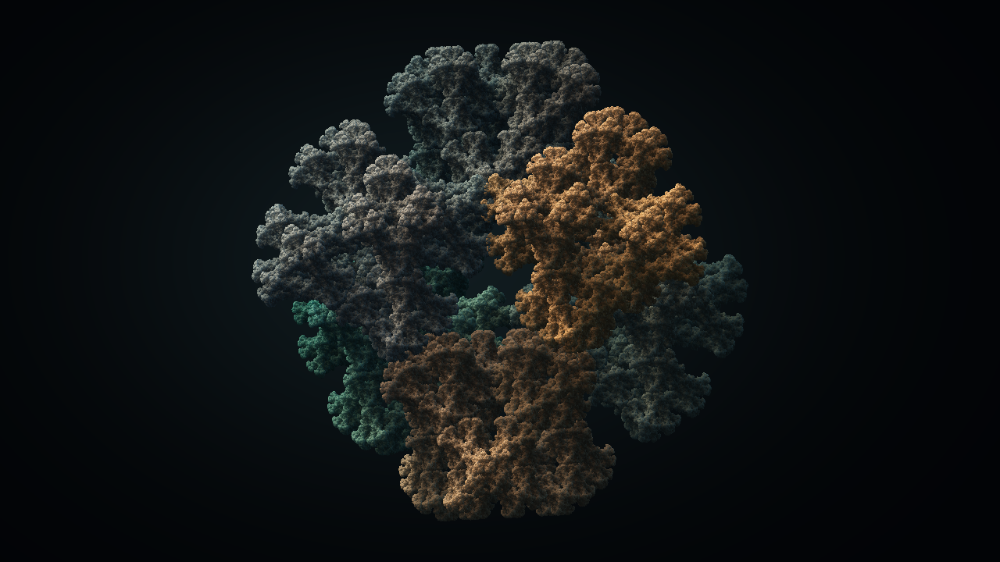

# Sixfold

A family of self-similar spatial fractals, explored through mathematics and moving images.

**[Visit the website](https://okwhynot-wtf.github.io/sixfold/)** ·
**[Exact definition](docs/definition.md)** ·
**[Current results](docs/results.md)** ·
**[Reproduce the work](docs/reproduce.md)**

**[Six films and 100 stills](https://okwhynot-wtf.github.io/sixfold/gallery/index.html)** ·
**[Download the visualisation edition](https://github.com/okwhynot-wtf/sixfold/releases/tag/visuals-2026-11-18)**

**Archived release DOI: [10.5281/zenodo.24336419](https://doi.org/10.5281/zenodo.24336419)**

Six contracting similarities arrange smaller copies around a central passage.
Their height, scale and tilt are coupled by an exact periodic contact condition.
This repository documents the construction and the investigations of its
dimensions, overlaps and independent loops.

The work is by **okwhynot-wtf**, with substantial assistance from OpenAI GPT
models through ChatGPT and Codex. The mathematical deductions await independent
review. The prior-art search identifies published relatives and leaves historical
originality open. See [provenance and AI use](docs/provenance.md).

## Start here

| Purpose | Source |
| --- | --- |
| Define the reference shape and the family exactly | [Definition](docs/definition.md) |
| Find each result, its scope and supporting argument | [Results and evidence](docs/results.md) |
| Run the computational checks or generate a point cloud | [Reproduction](docs/reproduce.md) |
| Compare published constructions | [Related work](docs/related.md) |
| Understand the rendering and add the films later | [Images and films](docs/media.md) |
| Prepare the paper and its supporting references | [Paper source map](docs/paper.md) |
| Cite the archived release and check its contents | [Archive and citation](docs/release.md) |

## Generate and verify

From the repository root, with [uv](https://docs.astral.sh/uv/) installed,

    uv run --isolated --python 3.12 --with-requirements requirements.txt python scripts/generate.py --depth 5 --output .build/sixfold.csv
    uv run --isolated --python 3.12 --with-requirements requirements.txt python scripts/verify.py --receipt .build/verification.json

The generator produces a finite point approximation of the reference member.
The verifier runs the current mathematical implementation checks in temporary
copies and reports their scope. The analytic arguments and applications of
published theorems are included in the research reports.

## Repository and website

The Markdown files in **docs** are the current public account. **research**
preserves the original phase reports, certificates, data and source, including
the intact handover manifest. Earlier reports record the state of the work at
their dates. The current results page identifies later resolutions.

The website is built from those same Markdown files. Edit the source document,
then rebuild or push to the main branch for GitHub Pages deployment.

    uv run --isolated --python 3.12 --with-requirements site-requirements.txt python scripts/build_site.py
    python -m http.server 8765 --directory _site

The homepage features Chromatic descent. The gallery includes all 100 JPEGs,
lossless PNG masters and six films. Film binaries are GitHub Release attachments;
the current TouchDesigner project, rendering source and still library are in
the repository. See [media instructions](docs/media.md) for the tested environment,
checksums and commands to download the films into the offline gallery.

## Credit and reuse

Code and original certificate data use the [MIT licence](LICENSE).
Writing, images and films use [CC BY 4.0](CONTENT-LICENSE.md).
[CITATION.cff](CITATION.cff) supplies citation metadata for the archived
18 November 2026 release, version **zenodo**:
[10.5281/zenodo.24336419](https://doi.org/10.5281/zenodo.24336419).
That archive contains the source, TouchDesigner project, all 100 JPEG
compositions and their PNG masters. The six MP4s remain separate GitHub
Release downloads. See [archive scope and remaining steps](docs/release.md).
