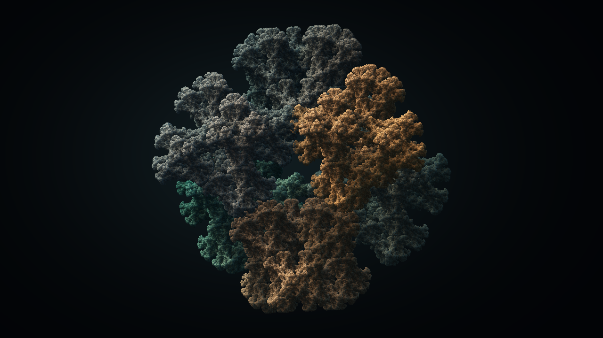
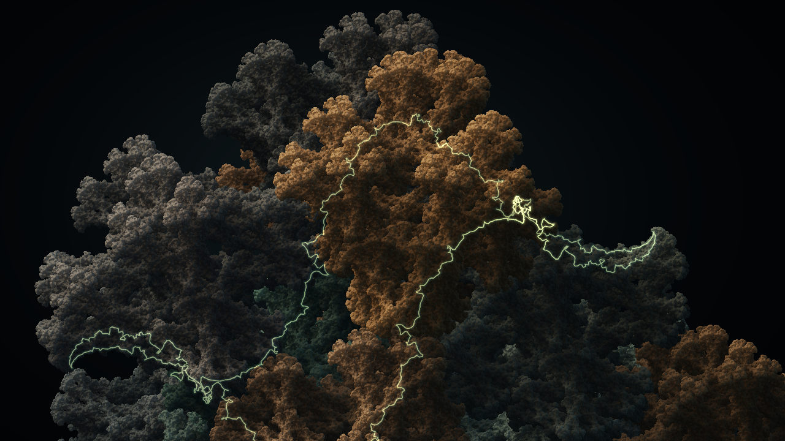

# Images and films

The website uses this existing rendered still while the film selection is prepared.

## What the rendering shows

The renderer samples depth-eight word centres, applies additional outer maps
and lights a finite-resolution surface around the field. Surface thickness,
colour, exposure and lighting are artistic choices. The mathematical
definition specifies the limiting set.

Camera studies include an orbit, a view along the two parallel passages,
an endless descent toward the fixed point of map 0, and a winding light
following smaller copies of an independent loop. The highlighted curve is
a polygonal visual guide associated with the winding proof.
[Rendering source](../research/sixfold/README.md)

## Add the selected film

Edit [site/media.json](../site/media.json). Set **video_url** to a public HTTPS
MP4 URL, or **youtube_id** to the selected YouTube video's ID. Use one field
at a time and update **caption**.

Rebuild or push to the main branch. The homepage uses the still when both
fields are empty. A direct film has playback controls and uses the still as
its poster. A YouTube film loads when the visitor selects Play film.

Record the source commit, render settings, output resolution and edits in
the media credit. Keep the master with the eventual archive if practical.
Large films can be hosted separately and linked from the repository.

The current source snapshot contains the shaders, textures, palettes and
camera code. Exports are being organised in the working **sixfold** folder.
