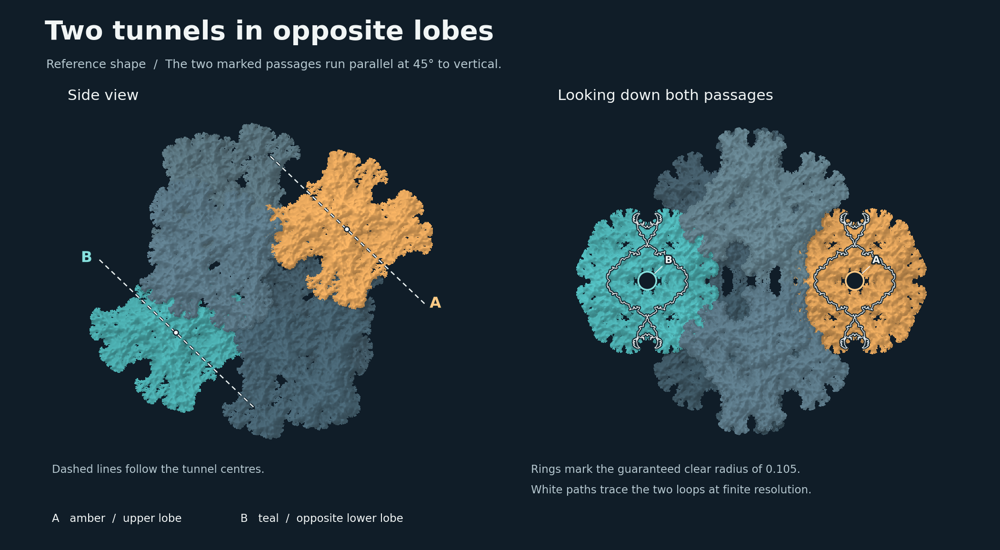

# Results and evidence

These are the current conclusions of the project. They combine analytic
arguments, published theorems and computational checks. Independent mathematical
review is pending. Successful verification reproduces the checks implemented
in the programs.

## Geometry and dimension

| Result | Scope | Argument and evidence |
| --- | --- | --- |
| Exact self-similarity and connectedness | Entire certified height interval | [Contact construction, phase 04](../research/fractal_handover/fractal_research_04/RESEARCH_04.md) |
| Each first-level lobe meets four neighbours and avoids its opposite | Entire interval | [Intersection classification, phase 06](../research/fractal_handover/fractal_research_06/RESEARCH_06.md) |
| Hausdorff dimension strictly between 2.1970 and 2.4150 | Entire interval | [Uniform bounds, phase 05](../research/fractal_handover/fractal_research_05/RESEARCH_05.md) |
| Assouad dimension exactly 3 | Entire interval | [Rotation and weak-separation argument, phase 07](../research/fractal_handover/fractal_research_07/RESEARCH_07.md) |
| Hausdorff dimension $\log6/\log(1/r)=2.4148914586\ldots$ | Reference member | [Algebraic and word-freeness argument, phase 08](../research/fractal_research_08/RESEARCH_08.md) |
| Hausdorff dimension $2.4149052346\ldots$ | Member with $u=19/71$ | [Second exact example, phase 08](../research/fractal_research_08/RESEARCH_08.md) |
| Open set condition and weak separation fail, including for every alternative finite similarity presentation of the same set | Entire interval | [Intrinsic dimension gap, phase 07](../research/fractal_handover/fractal_research_07/RESEARCH_07.md) |

Hausdorff dimension measures the scaling of the set as a whole. Assouad
dimension records the most demanding covering behaviour over locations and
scales. The values can differ when pieces overlap. Here the Hausdorff
upper bound also implies zero ordinary three-dimensional volume.

The two computed dimensions distinguish at least two members up to
bi-Lipschitz equivalence. Pairwise inequivalence throughout the interval remains open.

## Passages and independent loops

A central vertical cylinder of radius 0.0122 avoids the full fractal throughout
the interval. A path in the fractal winds once around it. Two parallel lines
through opposite lobes have clear radius greater than 0.105 and detect
independent loops. The winding arguments account for the surrounding copies.
[Central passage](../research/fractal_research_08/RESEARCH_08.md) · [Two loops](../research/fractal_research_09/RESEARCH_09.md)

At each of six exposed tips, smaller copies of a loop survive in the whole
attractor at arbitrarily small scales. The first integral singular homology
has a quotient $\prod_{n\ge0}\mathbb Z$, established through linked loops and
detecting curves whose separation is certified uniformly. The full homology
group and topological classification remain open.
[Shrinking loops and linking](../research/fractal_research_10_topology/RESEARCH_10.md)

The originally inherited tilted bore encounters neighbouring material when
extended straight inward with radius 0.0058. At the reference, the first
intrusion is between 1.325115 and 1.325120 units from the lobe translation
centre. Exact intersection with the zero-width centreline remains unresolved.
[Bore geometry and witnesses](../research/fractal_research_10_topology/RESEARCH_10.md)

## Questions that remain

- Historical originality and equivalence to less familiar published constructions.
- Hausdorff dimension at every height in the interval.
- Whether every distinct height gives a different metric geometry.
- The complete first-level intersections and full topology.
- Whether the attractor is homeomorphic to the Menger sponge.
- Exact intersection of the inherited tilted centreline with the set.
- Independent review of the arguments and theorem applications.

The [prior-art comparison](related.md) distinguishes several published
relatives. The [paper source map](paper.md) connects a future paper to its evidence.
