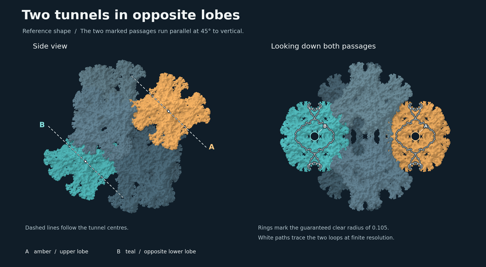

# Two independent through-holes in the full six-copy fractal

17 November 2026

**The upper lobe \(G_0(K)\) and the opposite lower lobe \(G_3(K)\) each contain a loop that stays essential in the full attractor.** Two parallel straight passages detect these loops independently. The results hold for every height \(0.7070\le h\le0.7072\) on the connected curve.

| | A · upper amber lobe | B · lower teal lobe |
|---|---|---|
| Passes through | \((1,0,h)\) | \((-1,0,-h)\) |
| Straight axis | \(y=0,\ x+z=1+h\) | \(y=0,\ x+z=-(1+h)\) |
| Direction, upwards | \((-1,0,1)/\sqrt2\) | \((-1,0,1)/\sqrt2\) |
| Guaranteed clear radius in the whole set | 0.105 | 0.105 |
| Winding of the upper loop | +1 | 0 |
| Winding of the lower loop | 0 | +1 |

The radius is in the handover’s coordinates, where each lobe centre is one horizontal unit from the vertical axis. For either of these specific lines, the distance to the fractal is strictly between 0.105 and 0.118. The axes are separated by \(\sqrt2(1+h)\), about 2.414 units at the reference height.

## Testing the full set

Phase 05 supplies integer word centres on a grid of size \(Q=2^{29}\). Every point in a depth-eight cylinder is within \(0.00055+2.14(0.476186)^8\) of its assigned grid centre, across the whole family. The first term accounts for the grid and parameter uncertainty and the second bounds the infinite tail. The handover verifier and the phase-08 central-loop verifier were rerun successfully.

For each axis take its sign \(s\in\{+1,-1\}\) and substitute \(\hat h=\lfloor 0.7071Q\rfloor/Q\) for its height in the grid calculation. Translating an axis back to its exact position changes any distance by at most \(|h-\hat h|\). Including that displacement brings the total error below 0.00631. For each integer centre \((i,j,k)\), twice the squared distance in grid units is exactly

\[
\big(i+k-sQ(1+\hat h)\big)^2+2j^2.
\]

All 1,679,616 centres were checked against both axes, including all neighbouring pieces. After allowing the error, every cylinder clears each axis by more than 0.105. Conversely, the cylinder of a minimizing centre contains a point of \(K\), which gives the upper bound 0.118. The verifier uses integer squares and rational thresholds and checks for overflow before the array multiplications. [Verification script](verify_tunnels.py) · [Numerical receipt with exact integer minima](tunnel_certificate.json)

## Why these are the two loops from the earlier construction

Let \(\gamma\) be the phase-08 loop. Its six successive portions join the contacts on either side of \(G_j(K)\) by paths inside that piece. The six contacts form a regular hexagon in \(z=0\) around the origin. The paths exist because a connected self-similar attractor is path-connected. Define the two smaller loops by \(\gamma_A=G_0(\gamma)\) and \(\gamma_B=G_3(\gamma)\). Both are paths in the full \(K\). [Phase-08 construction](../fractal_research_08/RESEARCH_08.md) · [Badger and Vellis on path-connectedness](https://arxiv.org/abs/1910.08850)

Orient both axes upwards as in the table. Use perpendicular coordinates \((X/\sqrt2,Y)\), with \(X=x+z-s(1+h)\) and \(Y=y\). These have the stated orientation. For each selected child \(i=0,3\), the six subpieces \(G_iG_j(K)\) pass the following test. For \(j=0,\ldots,5\), respectively, use the normal coefficients

\[
(a,b)=(1,0),\ (-1,2),\ (1,2),\ (-1,0),\ (1,-2),\ (-1,-2).
\]

Throughout the corresponding subpiece, \((aX+bY)/\sqrt{2a^2+b^2}>0.06\). The same grid and error bound prove all twelve inequalities. The projected path in each subpiece and its endpoint chord therefore lie in the same convex open half-plane away from the passage centre. Each path can be deformed to that chord in the punctured projection plane.

For the loop tested against its own axis, the resulting six chords trace the projected contact hexagon. Both children have the same rotation about the \(y\)-axis by \(\alpha\). On the original contact plane, projection after either child map acts in centred coordinates by

\[
(x,y)\longmapsto r\big((\cos\alpha-\sin\alpha)x/\sqrt2,\ y\big).
\]

Its determinant is positive on the entire curve. Thus the hexagon, and hence the loop, winds once around the passage. This argument works for any of the connecting paths allowed in phase 08.

For the cross-check, the entire other child lies in a radius-\(2.14r\) ball around its centre. The distance of that centre from the tested axis is \(\sqrt2(1+h)\). Even the enclosing ball clears the axis by more than 1.39. A loop in that ball has zero winding about that axis.

Winding around either line defines an integer-valued homomorphism on the first singular homology of \(K\), since the whole fractal misses both lines. Evaluating an integer relation \(m[\gamma_A]+n[\gamma_B]=0\) gives \(m=0\) at A and \(n=0\) at B. The two classes are therefore independent in \(H_1(K;\mathbb Z)\). Other tunnels and relations involving other loops remain open.

## Following the original direction through the child

The 45-degree passages are convenient straight sight lines. The original centreline inherited by the upper child instead has \(y=0,\ x=1+(z-h)\tan\alpha\). It can also be followed through the whole child at positive clearance. Follow this line down from \(+\infty\) to \(z=-1/4\), then continue vertically down at the \(x\) reached there. The resulting route clears the full fractal by more than 0.0058. Central inversion gives the lower child’s route.

For the upper sloping ray, its own child inherits clearance \(0.0122r>0.0058\) from phase 08. The bend and the entire vertical exit sit outside that child’s enclosing ball by more than 0.0058. For all five neighbours, the verifier tests their 6,480 depth-five centres against both rays. It uses the rational slope \(15/26\) and height 0.7071 only as computational proxies. The corresponding change in horizontal position is less than 0.003 throughout \(|z|\le3\), covering any point of either route close to the radius-2.14 fractal. The test allows both that error and the full depth-five cylinder tail. Whether the inherited line would also pass all the distant pieces if continued straight past the bend is unresolved. The 45-degree lines in the table are certified straight to infinity in both directions.

## Reading and reproducing the figure

The right view looks directly along both straight passages. The marked circles are drawn to scale. The white lines join actual shared-contact locations through a recursive chain of pieces. Each of the 1,434 drawn chords per loop can be replaced by a path in the same depth-eight cylinder. Those cylinders have diameter below 0.0114, which bounds the geometric approximation error at the reference. The script separately checks the winding of the displayed paths. The half-plane argument above proves the winding of the actual loops.

Run from the workspace root with the pinned handover dependencies.

~~~powershell
uv run --isolated --python 3.12 --with-requirements fractal_handover/requirements.txt python -B fractal_research_09/verify_tunnels.py
uv run --isolated --python 3.12 --with-requirements fractal_handover/requirements.txt python -B fractal_research_09/render_tunnels.py
~~~
