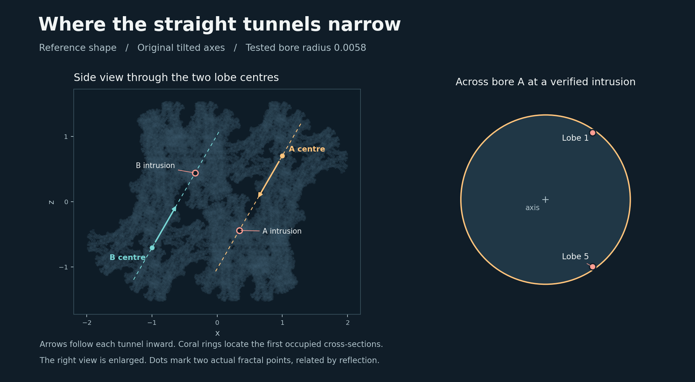

# The original tilted bores and a sequence of independent holes

17 November 2026

## Where the straight bores meet the fractal

Follow the upper lobe’s inherited axis straight inward, starting at \((1,0,h)\). A straight rod of radius **0.0058** reaches neighbouring material after **1.325115 to 1.325120 units** on the reference shape. The centre of the first occupied cross-section is approximately **\((0.33814,0,-0.44088)\)**. Lobes 1 and 5 enter from opposite sides of the symmetry plane. On the opposite lower lobe the picture is reversed through the origin, with lobes 4 and 2 entering the bore. The inward travel to the first occupied section is between **1.320 and 1.330** throughout the certified height family. The outward half-ray is clear at the tested radius.

At the reference height, the upper-bore witness pictured on the right is near \((0.340917,0.004592,-0.442484)\), just inside the cylinder. The witness from lobe 5 has the same \(x,z\) and the opposite \(y\). The picture uses a cross-section within five millionths of a unit of first intrusion. A bore is called occupied here as soon as even one fractal point enters it.

**The zero-width centreline question is open.** Three explicitly addressed points in lobe 1 have reference distances strictly between \(10^{-35}\) and \(10^{-33}\) from the line. Their mirror images in lobe 5 have identical distances. This proves an upper bound on the maximum possible clear radius even if the centreline itself misses the set. The same addresses come within 0.001 throughout the family. Rounded reference positions are given below.

| Witness | \(x\) | \(y\), to six decimals | \(z\) |
|---|---:|---:|---:|
| Nearer | 0.284205 | 0.000000 | −0.534425 |
| Middle | 0.143485 | 0.000000 | −0.778502 |
| Farther | 0.062578 | 0.000000 | −0.918833 |

An exhaustive interval calculation further restricts every possible exact hit on the upper axis to lobes 1 and 5. At the reference, all such hits must be in the listed disjoint height bands between \(z=-0.9196\) and \(-0.5342\). The receipt gives the bands and the separate, wider enclosures valid for the family. Central inversion gives the corresponding lower-axis data. [Coordinate and address certificate](certificate.json)

## How the tests distinguish a near approach from an intersection

Put \(c=\cos\alpha\), \(s=\sin\alpha\), \(t=(1,0,h)\), \(v=(s,0,c)\). At a point \(P=(x,y,z)\), its inward position and squared distance to the upper axis are

\[
T=-v\cdot(P-t),\qquad D^2=[c(x-1)-s(z-h)]^2+y^2.
\]

The first intrusion is the minimum of \(T\) on \(K\cap\{D\le0.0058\}\). This compact set is nonempty by an explicit eventually periodic address. At the reference, the witness has the prefix **1404022400020420424** followed by zeros forever. A second witness works uniformly across the height curve. They are actual points because the zero tail is the fixed point of \(G_0\). The verifier encloses that point and then applies the prefix inside-out.

For the complementary lower bound on travel, every depth-\(n\) copy lies within \(2.14r^n\) of its word centre. A branch is discarded when its whole ball is outside the tube or beyond the proposed first-section threshold. The upper child itself has clearance \(0.0122r>0.0058\) by phase 08. The three other nonadjacent siblings clear the bore by their enclosing balls. All remaining possibilities were tested, with the reference exclusion closing by depth 16. Reflection in \(y=0\) exchanges lobes 1 and 5 while fixing the axis and the travel coordinate. It therefore transfers even the earliest intrusion to its partner.

For the \(10^{-33}\) witnesses, the program repeats the interval contraction for \(r,u\) in a rectangle of radius \(10^{-45}\) about the handover’s reference centres, enclosing exact \(h=1/\sqrt2\). It then bounds each of the three 105-letter prefixes followed by a zero tail with 256-bit ball arithmetic. Finite-depth pruning localizes any exact centreline hit; surviving branches alone do not supply one. The phase-09 straight 45-degree passages and the narrower bent exits retain their established clearances.

## Infinitely many independent holes survive in the full attractor

For **every** member of the certified family there is a sequence of loops that are independent in the first integral singular homology of the whole fractal. They accumulate at the fixed point \(p\) of \(G_0\), approximately \((1.88117,0,0.44205)\) at the reference. Each loop is an exact copy of the preceding loop at scale \(r^4\), about 0.0514. Symmetry gives the same conclusion at the other five corresponding tips.

The issue is whether other pieces can fill a small loop. To detect that, we put a closed rectangular wire in the **complement** of the entire fractal, linked once with the upper loop. We then prove that each of its smaller copies stays in that complement.

1. Let \(\gamma_A\) denote the upper loop from phase 09. Its winding about the straight 45-degree line through \(t\) is \(+1\). Take \(e=(1,0,1)/\sqrt2\), \(d=(-1,0,1)/\sqrt2\), and \(a=1.03\). Let \(D\) be the **boundary** of the planar rectangle \(t+ve+wd\), \(0\le v\le a,\ |w|\le a\).
2. The edge \(v=0\) lies on the certified clear line. The other three edges are outside the enclosing ball of \(G_0(K)\) because \(a>2.14r\). Each sibling ball lies strictly on the other side of the plane \(e\cdot(x-t)=0\). Thus the wire is disjoint from the full set. Orient it so that its edge on the line follows the positive axis direction. Its linking number with \(\gamma_A\) is \(+1\). Indeed, compactify the straight line in \(S^3\). The replacement arc formed by the other three edges and the removed tails both lie outside the child’s enclosing ball. They are homotopic there relative to their endpoints, since the exterior of the ball in \(S^3\) is simply connected.
3. The open ball of radius 0.96 around \(p\) misses **every sibling** of \(G_0(K)\). All of \(G_0(D)\) lies within radius 0.95 of \(p\), by checking its four corners. Because \(G_0\) is a similarity fixing \(p\), all later wire images stay in that ball. Inductively, if \(G_0^{j-1}(D)\) misses \(K\), its image misses \(G_0(K)\) by injectivity and misses the siblings by location. This proves full-set avoidance at every depth.
4. The distance from \(p\) to \(D\) exceeds 0.19. The entire \(G_0^4(G_0(K))\) lies within radius 0.11 of \(p\). Take \(\gamma_n=G_0^{4n}(\gamma_A)\) and \(D_m=G_0^{4m}(D)\). Their linking number is \(+1\) for \(m=n\), by similarity. For \(n>m\), the entire smaller loop is in a ball disjoint from the wire, giving linking number zero. All four constants are interval-checked across the family.

Pair a finite integer relation among the \(\gamma_n\) against the wire at its smallest index. It reads off that first coefficient. Repetition shows that every coefficient vanishes. In particular every neighbourhood of \(p\) contains loops that cannot be contracted even inside the full \(K\).

### The winding records can encode an arbitrary integer sequence

There is a stronger consequence for singular homology. The homomorphism from \(H_1(K;\mathbb Z)\) to \(\prod_{m\ge0}\mathbb Z\) recording linking against all \(D_m\) is **surjective**. Choose a path inside \(G_0(K)\) from \(p\) to \(\gamma_A\), and go out and back along it to base that loop at \(p\). Shrinking these based loops as above keeps their entire connecting paths in the same small balls. Given desired winding records \(b_0,b_1,\ldots\), traverse the first loop \(b_0\) times, with negative exponents reversing direction. At step \(m\), the earlier finitely many loops have contributed some integer to record \(m\). Traverse the \(m\)-th loop the required additional number of times. Its own contribution is one per turn and all earlier records are unchanged.

Put the successive stages on time intervals of lengths \(1/2,1/4,\ldots\) and finish at \(p\). This is a continuous loop because the diameters shrink to zero. For any fixed wire, the entire tail after its stage stays in a single ball disjoint from that wire, so its winding contribution is zero even for the infinite concatenation. Hence all prescribed records are attained, and the full set has uncountably many distinct first-homology classes. This calculation gives a quotient of the homology group. Its complete group structure and the topological classification of this fractal remain open. The shrinking-loop method is classical; here the extra geometric argument verifies that the detecting wires avoid all overlapping pieces. [Hatcher, *Algebraic Topology*, Example 1.25](https://pi.math.cornell.edu/~hatcher/AT/AT-doublepage.pdf)

## Reproduction and visualisation data

The new calculations are isolated in **fractal_research_10_topology**. The JSON records A’s points, axes of the cross-section, conservative coordinate boxes and scale bounds. Positions for B are obtained by negating all three coordinates. The side-view silhouette in the figure uses the reference depth-eight word centres. The mathematical decisions use interval bounds. Independent mathematical review of the deductions is outstanding.

~~~powershell
uv run --isolated --python 3.12 --with-requirements fractal_handover/requirements.txt --with python-flint==0.9.0 python -B fractal_research_10_topology/verify.py
uv run --isolated --python 3.12 --with-requirements fractal_handover/requirements.txt python -B fractal_research_10_topology/plot_locator.py
~~~
